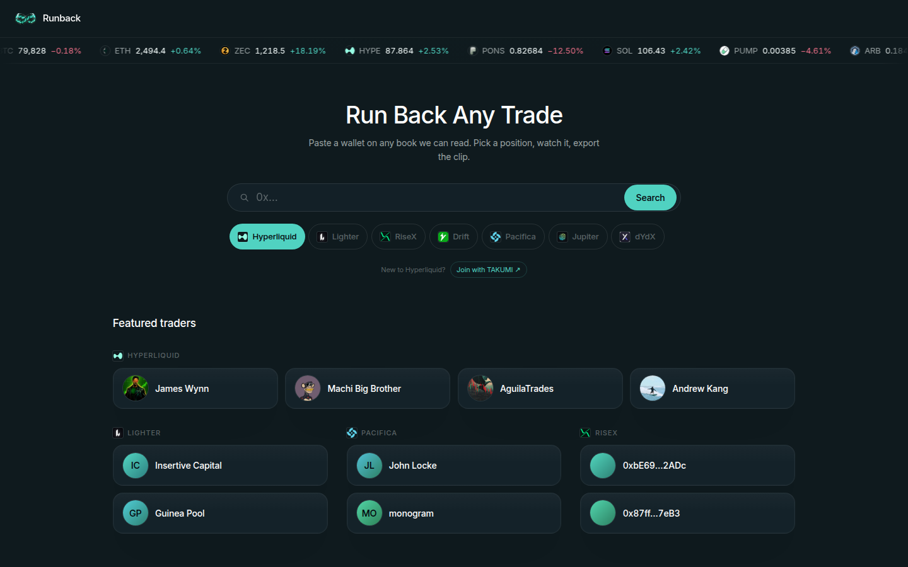

# Runback

You paste a wallet from a perp book we can actually read. Fills fold into positions, you open one, and the chart plays it from the first fill to the last. Export writes a clip of that replay.

[runbackpnl.vercel.app](https://runbackpnl.vercel.app)



The paste is `0x` on Hyperliquid, Lighter and RiseX, a Solana key on Drift, Pacifica and Jupiter, and `dydx1` on dYdX. History that has to be signed is out of reach.

## Run it

```bash
npm install
npm run dev
```

Hyperliquid, Lighter, dYdX and Jupiter send `access-control-allow-origin: *`, so the browser calls them. Pacifica, RiseX and Drift go through `/api/x/{venue}` because they omit CORS.

Hyperliquid rate-limits by IP at 1,200 weight a minute, so those calls stay in the browser and each visitor spends their own quota.

MIT. [LICENSE](LICENSE).
