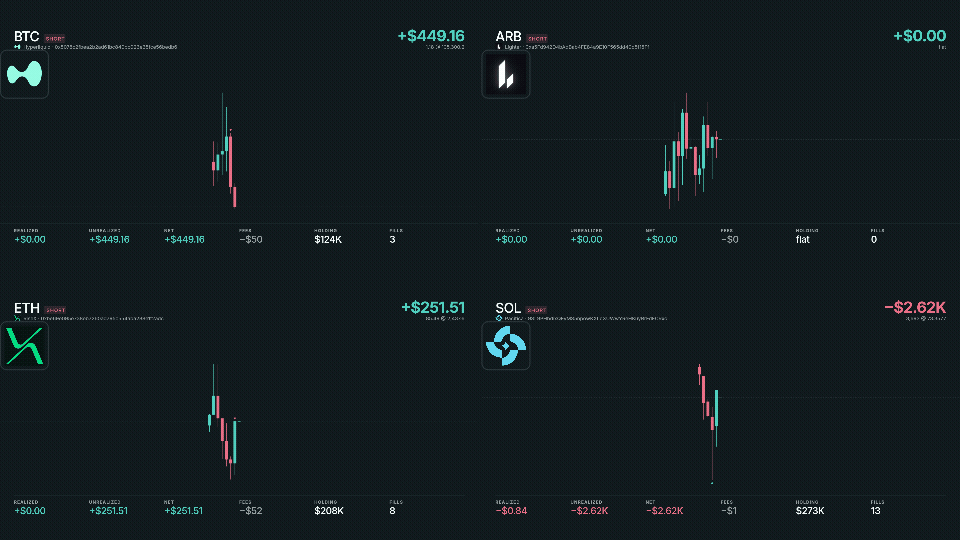

# Runback

[](https://github.com/Takumixbt/runback/actions/workflows/ci.yml)
[](LICENSE)

Paste a perp wallet. Pick a position. Watch it trade, fill by fill, then export the clip.

**[Live demo](https://runbackpnl.vercel.app)** · [MIT License](LICENSE)



## What it does

Runback reads a public fill tape, folds it into positions, and plays one back on a chart — candles forming, arrows on the fills, a running PnL, and a soundtrack that follows the arrows. Export writes an MP4 of that same replay, audio included, at 16:9, 9:16 or 1:1.

No account, no API key, no signing. If the book publishes history, you can replay it.

## Venues

| Book | Address | How it is read |
| --- | --- | --- |
| [Hyperliquid](https://app.hyperliquid.xyz) | `0x…` | Browser, CORS `*` |
| [Lighter](https://app.lighter.xyz) | `0x…` | Browser, CORS `*` |
| [dYdX](https://dydx.trade) | `dydx1…` | Browser, CORS `*` |
| [Jupiter](https://jup.ag) | Solana | Browser, CORS `*` |
| [RiseX](https://rise.trade) | `0x…` | Proxied at `/api/x/risex` |
| [Pacifica](https://app.pacifica.fi) | Solana | Proxied at `/api/x/pacifica` |
| [Drift](https://app.drift.trade) | Solana | Proxied at `/api/x/drift` |

History that has to be signed is out of reach. Hyperliquid rate-limits by IP (1,200 weight/min); those calls stay in the browser so each visitor spends their own quota.

## Stack

Next.js 16 · React 19 · TypeScript · Tailwind v4 · [lightweight-charts](https://github.com/tradingview/lightweight-charts) · Web Audio · WebCodecs ([mediabunny](https://github.com/Vanilagy/mediabunny))

## Run locally

```bash
git clone https://github.com/Takumixbt/runback.git
cd runback
npm install
npm run dev
```

Open [http://localhost:3000](http://localhost:3000). Nothing in `.env.example` is required.

```bash
npm run typecheck
npm run lint
npm test
npm run build
```

CI runs those four on Node 20 and 22.

`npm run check` walks a live Hyperliquid wallet, folds it, and reconciles bar-by-bar PnL against the exchange's per-fill number. It is not in CI: it fails on someone else's rate limit.

## How a replay is built

1. **Fills** — each venue adapter maps native history onto one tape (`coin`, `px`, `sz`, `side`, `closedPnl`, …).
2. **Episodes** — the tape is folded into positions: entries, adds, flips, exits, liquidations.
3. **Window** — opening a row fetches candles at an interval that fits the hold.
4. **Replay** — the chart walks one bar at a time (600ms at 1×). Markers and pings share the same bar list, so an arrow without a sound is a bug.
5. **Export** — an off-screen chart is stepped and encoded with WebCodecs. The soundtrack is rendered offline, not recorded from the speakers.

The arithmetic lives in `src/lib/fill.ts` and `src/lib/episodes.ts`. `tests/fill.test.ts` is the cases that shipped wrong once.

## Contributing

Issues and pull requests are welcome. Please run `npm run typecheck`, `npm run lint` and `npm test` before opening a PR. Keep venue adapters limited to books that publish an unsigned public tape.

## License

[MIT](LICENSE) © Takumi
