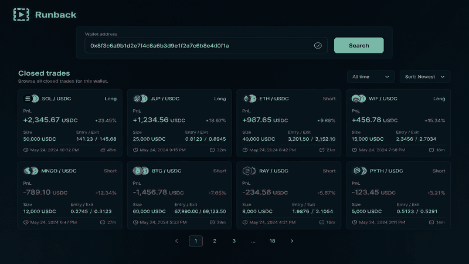

# Runback

Paste a perp wallet. Watch the position play out. Export the clip.

[runbackpnl.vercel.app](https://runbackpnl.vercel.app)



Hyperliquid, Lighter, RiseX, Drift, Pacifica, Jupiter, dYdX. Same shape on every book: an address in, a list of trades out, one of them on the chart.

## How to

1. **Paste a wallet.** `0x…` on Hyperliquid, Lighter, RiseX. A Solana key on Drift, Pacifica, Jupiter. `dydx1…` on dYdX.
2. **Pick the book** if the address fits more than one.
3. **Open a position.** It runs from the first fill to the last, with the drawdown a PnL card leaves off.
4. **Export** if you want the file. Nothing to log into.

That’s the whole product.

## Run it

```bash
npm install
npm run dev
```

No `.env`. No key. No account. The browser talks to the books that allow it. Pacifica, RiseX and Drift go through `/api/x/{venue}` only because they don’t send CORS headers.

## What you paste

| Book | Address |
| --- | --- |
| Hyperliquid, Lighter, RiseX | `0x…` |
| Drift, Pacifica, Jupiter | Solana |
| dYdX | `dydx1…` |

Books that need a signed history stay out. If it isn’t in that table, we can’t read it.

## Check it

```bash
npm run typecheck
npm run lint
npm test
npm run build
```

Those four are CI. This one walks a live wallet and reconciles our bar-by-bar PnL against the exchange:

```bash
npm run check           # picks a wallet off the tape
npm run check -- 0x…    # or one you name
```

`tests/fill.test.ts` is the arithmetic that isn’t safe to leave to a live book. Every case in it shipped as a bug once.

A vulnerability goes in [SECURITY.md](SECURITY.md), not the issue tracker.

## Why the browser does the reading

Hyperliquid rate-limits by IP. Put that on a server and every visitor shares one quota. Read from the browser and each person spends their own.

The front-page trader list is the one shared server read. Everything else a visitor triggers is theirs.

## Licence

MIT. See [LICENSE](LICENSE).
